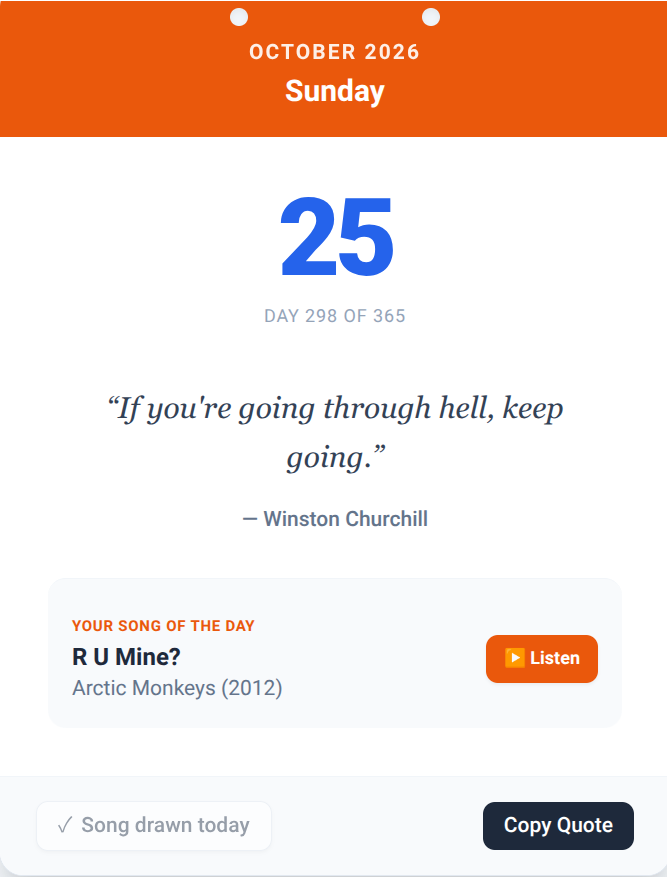

# Daily Quote & Song Calendar
A lightweight, client-side web application designed for **Tiny Tool Town** that presents a daily
calendar sheet with a unique historical quote and an exclusive "Song of the Day" draw for every
day of the year.
##  Live Demo
https://Jorgoi.github.io/dailyspark/

##  Features
- **365 Daily Quotes**: Curated wisdom from world history, deterministically shuffled and
synchronized annually using a Mulberry32 PRNG so everyone sees the same quote on the
same day.
- **Song of the Day**: Discover a handpicked track from rock classics, soul, reggae, blues, or
indie-pop.
- **One Draw per Day Constraint**: A built-in `localStorage` restriction ensures you can only
draw your song once per calendar day.
- **100% Client-Side**: No backend required, fully static and lightning fast.
- **Clean UI**: Styled with Tailwind CSS to mimic a classic tear-off desk calendar.
## ️ Tech Stack
- HTML5
- Tailwind CSS (via CDN)
- Vanilla JavaScript (ES6)
##  License
This project is licensed under the MIT License.
